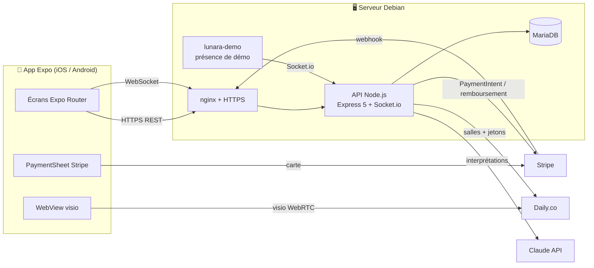
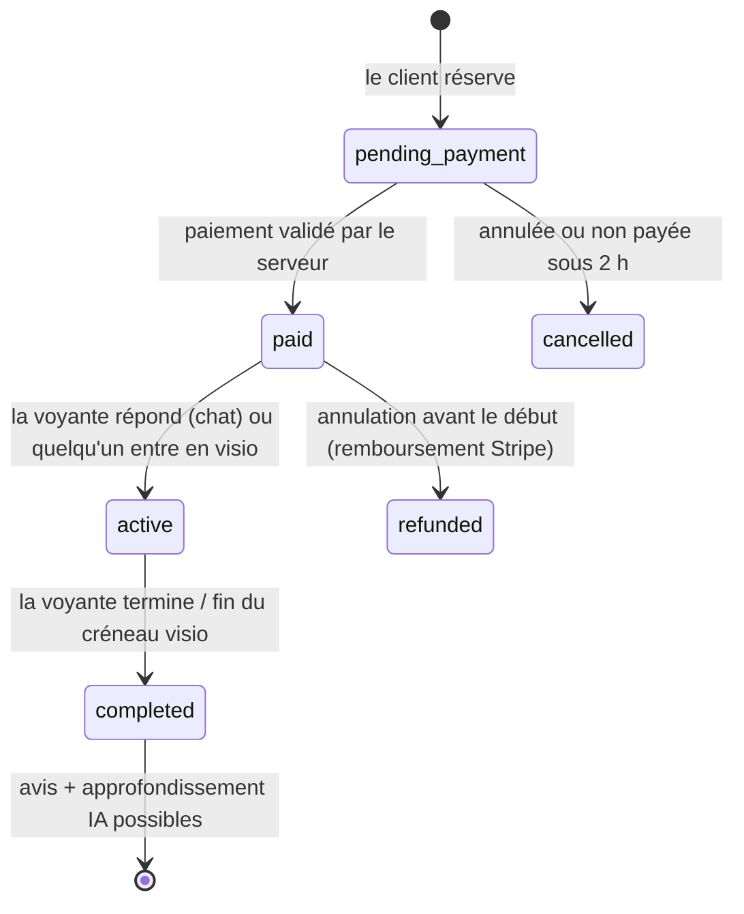
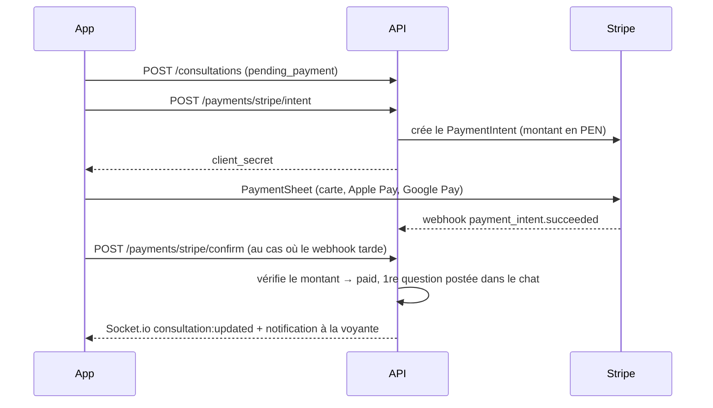
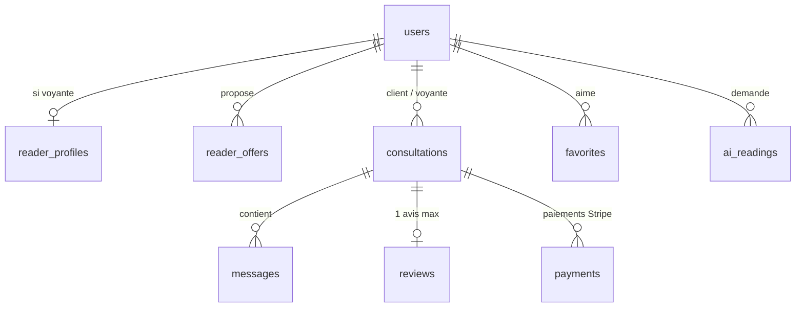

<div align="center">

# 🌙 Lunara

### Tarot y guía espiritual — *Respuestas reales para tu camino*

Marketplace mobile qui met en relation des clients (Pérou en priorité, interface en espagnol + mode français)
avec des **tarologues vérifiés** : chat par forfait de questions, **visio** de 30 min / 1 h,
paiement **Stripe**, **avis vérifiés** et **IA (Claude)** pour approfondir une lecture.


</div>

---

## 📑 Sommaire

1. [Tester l'app en 5 minutes](#-tester-lapp-en-5-minutes) ← **commence ici**
2. [Scénarios de test](#-scénarios-de-test)
3. [Ce que fait l'app](#-ce-que-fait-lapp)
4. [Architecture](#-architecture)
5. [Lancer le projet pour développer](#-lancer-le-projet-pour-développer)
6. [Structure du code](#-structure-du-code)
7. [Fonctionnement en détail](#%EF%B8%8F-fonctionnement-en-détail)
8. [Référence de l'API](#-référence-de-lapi)
9. [Temps réel (Socket.io)](#-temps-réel-socketio)
10. [Base de données](#-base-de-données)
11. [Design system](#-design-system)
12. [Traductions (espagnol / français)](#-traductions-espagnol--français)
13. [Production et déploiement](#-production-et-déploiement)
14. [Dépannage](#-dépannage)
15. [Limites et prochaines étapes](#-limites-et-prochaines-étapes)

---

## 🚀 Tester l'app en 5 minutes

Tout tourne déjà sur le serveur : **https://api-lunara.duapar.fr**. Tu n'as besoin que de ton téléphone (et d'un PC si tu veux lancer l'app toi-même).

### Option A — Bastien lance l'app, tu scannes

1. Installe **Expo Go** (App Store / Play Store), à jour.
2. Dans Expo Go → onglet **Profil** → connecte-toi avec le compte Expo du projet (`duapar13`, demande le mot de passe à Bastien).
3. Bastien lance `npx expo start --tunnel` et t'envoie le QR code : scanne-le (appareil photo sur iPhone, depuis Expo Go sur Android).

### Option B — tu lances l'app toi-même

```bash
git clone https://github.com/Duapar13/Lunara.git
cd Lunara/mobile
npm install
cp .env.example .env          # pointe déjà sur le serveur en ligne
npx expo login                # même compte Expo que dans ton Expo Go
npx expo start --tunnel
```

Scanne le QR code avec Expo Go. Prérequis : [Node.js 20+](https://nodejs.org).

### 🔑 Comptes de démo

Mot de passe de tous les comptes : **`lunara123`**

| Rôle | E-mail | Ce que tu peux faire |
|---|---|---|
| 🧑 Client | `cliente@demo.lunara.app` | Chercher, réserver, payer, chatter, visio, avis, IA |
| 🔮 Voyante | `valeria@demo.lunara.app` | Recevoir des consultations, répondre, tirage, visio |
| 🔮 Voyante | `diego@demo.lunara.app`, `sofia@…`, `mateo@…`, `isabella@…`, `lucia@…`, `camila@…`, `andres@…` | Idem |

> Valeria, Sofía, Mateo et Isabella sont **toujours « En línea »** (un petit service les garde connectées pour la démo).

### 💳 Payer en test (aucun vrai argent)

| Carte | Résultat |
|---|---|
| `4242 4242 4242 4242` | ✅ Paiement accepté |
| `4000 0000 0000 0002` | ❌ Carte refusée |
| `4000 0025 0000 3155` | 🔐 Demande une validation 3-D Secure |

Date d'expiration : n'importe quelle date future (ex. `12/34`) · CVC : `123` · code postal : n'importe lequel.

### 🇫🇷 Mettre l'app en français

Sur l'écran d'accueil, touche **🇫🇷 FR** en haut à droite (ou plus tard : **Profil → Langue**). L'IA répond aussi en français.

---

## 🧪 Scénarios de test

L'idéal est d'être **deux** : un sur le compte client, l'autre sur un compte voyante.

### 1. Chat en temps réel (le cœur de l'app)

| 🧑 Client (`cliente@…`) | 🔮 Voyante (`valeria@…`) |
|---|---|
| Accueil → touche **Valeria Luna** | Reste sur le **Tableau de bord** |
| Onglet **Chat** → forfait **3 questions** → **Réserver** | |
| Écris ta 1ʳᵉ question → **Payer et réserver** → carte `4242…` | 🔔 Bannière « Nouvelle consultation » |
| Tu arrives dans le chat, ta question est déjà envoyée | Ouvre la consultation, réponds → elle passe « En cours » |
| Pose tes questions : compteur **1/3, 2/3, 3/3** puis le champ se bloque | Voit « … écrit » quand le client tape |
| | **Enregistrer le tirage** : choisis 3 cartes + un message |
| | **Terminer la consultation** |
| **Laisser mon avis** (étoiles + commentaire) | L'avis apparaît sur son profil public |
| **Approfondir avec l'IA** : pose une question sur le tirage | |

### 2. Visio

Le serveur est en **mode test** : on peut lancer une visio tout de suite, même avec une voyante hors ligne.

1. Client → une voyante → onglet **Visio** → **30 min** → **Maintenant** → paiement `4242…`
2. Client et voyante ouvrent la consultation → **Rejoindre la visio** → autoriser caméra + micro.
3. Un compte à rebours s'affiche ; la salle se ferme toute seule à la fin.

> Teste sur **deux téléphones différents**, sinon tu ne vois que ta propre caméra.

### 3. Tirage du jour avec l'IA

Onglet **Tarot** → choisis un thème (et une question si tu veux) → **Mélanger les cartes** → choisis 3 cartes (elles se retournent) → **Révéler ma lecture**. Limite : 5 interprétations IA par jour et par compte.

### 4. Annulation et remboursement

Réserve une visio sur un **créneau** (pas « Maintenant »), puis dans la consultation : **Annuler et rembourser** → le remboursement est visible côté Stripe.

### 5. Espace voyante

Connecte-toi en voyante : interrupteur **En ligne**, gains du mois, **Forfaits et tarifs** (prix des 5 forfaits, désactivation), **Horaires** (jours et plages de visio), **Modifier mon profil public** (photo, bio, spécialités, langues).

### 6. Créer de vrais comptes

Écran d'accueil → **Créer mon compte** → « Je cherche une consultation » ou « Je suis expert(e) ». Un nouveau profil de voyante reste **« en cours de vérification »** tant qu'un admin ne l'a pas validé.

---

## ✨ Ce que fait l'app

### Côté client
- 🏠 **Accueil** : salutation selon l'heure, **phase de la lune du jour** (calculée en vrai), « stories » des voyantes en ligne, carrousel d'experts à la une, catégories (Amour, Travail, Argent, Famille, Énergie, Astrologie), tirage du jour.
- 🔎 **Explorer** : recherche, filtres par spécialité, « en ligne maintenant », tri (recommandés, mieux notés, prix), favoris ❤️.
- 👤 **Fiche voyante** façon Airbnb : note, nombre de consultations, années d'expérience, bio, langues, forfaits, **avis vérifiés**.
- 📅 **Réservation** : chat 1 / 3 / 5 questions ou visio 30 / 60 min, « Maintenant » ou un créneau sur 7 jours, paiement Stripe (carte, Apple Pay, Google Pay).
- 💬 **Consultation** : chat temps réel, compteur de questions, indicateur « écrit… », visio, tirage de la voyante, avis, approfondissement IA, annulation remboursée.
- 🃏 **Tarot du jour** : 22 arcanes majeurs, cartes qui se retournent en 3D, interprétation IA.

### Côté voyante
- 📊 Tableau de bord : en ligne / hors ligne, gains du mois (net de commission), consultations ouvertes, note.
- 💰 Ses propres prix pour les 5 forfaits · 🗓 ses horaires de visio · ✍️ sa fiche publique.
- 🃏 Saisie du tirage (cartes + sens inversé + message) que le client retrouve et peut approfondir avec l'IA.

### Côté admin
- ✅ Validation / refus des profils de voyantes avant publication (Profil → Validation des experts, compte avec le rôle `admin`).

### Règles de la marque respectées
- 70 % de surfaces sobres, 20 % de violet, 10 % d'or · Playfair Display + Inter · espagnol du Pérou · prix en `S/`.
- **Aucune statistique inventée en production** : une nouvelle voyante affiche « Nouveau sur Lunara » ; les avis ne viennent que de consultations terminées (1 avis par consultation). ⚠️ Les données de démo, elles, sont fictives (voir la check-list de lancement).

---

## 🏗 Architecture



| Brique | Techno | Pourquoi |
|---|---|---|
| App | Expo SDK 57, React Native 0.86, Expo Router, TypeScript | Fonctionne dans **Expo Go**, sans build native |
| Animations | Reanimated 4, expo-linear-gradient, react-native-svg | Ciel étoilé, cartes 3D, dégradés |
| API | Node.js, Express 5, zod | Simple à héberger sur la Debian |
| Temps réel | Socket.io | Chat, présence « en ligne », notifications |
| Base | MySQL 8 / MariaDB | Déjà présent sur le serveur |
| Paiement | Stripe (PaymentSheet + webhook) | Cartes du monde entier, Apple/Google Pay, devise PEN |
| Visio | Daily.co dans une WebView | Compatible Expo Go (pas de module WebRTC natif) |
| IA | Claude (`claude-opus-5-5`) côté serveur | La clé ne quitte jamais le serveur |

---

## 💻 Lancer le projet pour développer

### Prérequis
- **Node.js 20+** · **Git** · **Expo Go** sur ton téléphone
- Pour le serveur en local : **MySQL 8** ou **MariaDB 10.6+**

### App mobile seule (contre le serveur en ligne) — le plus simple

```bash
cd mobile
npm install
cp .env.example .env
npx expo start            # même Wi-Fi que le téléphone
npx expo start --tunnel   # ou n'importe où (passe par ngrok)
```

Raccourcis dans le terminal Expo : `r` recharger · `j` debugger · `w` version web (sans paiement). Pour vider le cache : relance avec `npx expo start -c`.

### Serveur en local (optionnel)

```bash
cd server
npm install
cp .env.example .env      # remplis au minimum JWT_SECRET et DB_*
mysql -u root -p -e "CREATE DATABASE lunara CHARACTER SET utf8mb4;"
npm run migrate           # crée les tables
npm run demo:seed         # données de démo
npm run dev               # API sur http://localhost:4000 (redémarre à chaque modification)
npm run demo:presence     # (autre terminal) met 4 voyantes de démo en ligne
```

Puis dans `mobile/.env` : `EXPO_PUBLIC_API_URL=http://<ip-locale-de-ton-pc>:4000`.
Sans clés Stripe / Daily / Claude, l'app marche quand même : ces fonctions répondent « non disponible ».

### Scripts utiles

| Où | Commande | Rôle |
|---|---|---|
| `mobile/` | `npx tsc --noEmit` | Vérifie les types |
| `mobile/` | `npx expo lint` | Lint (règles React Compiler incluses) |
| `mobile/` | `npx expo-doctor` | Vérifie la compatibilité des dépendances avec le SDK |
| `mobile/` | `npx expo install <paquet>` | **Toujours** utiliser ça pour ajouter une lib (bonne version pour le SDK) |
| `server/` | `npm run migrate` | Applique `src/schema.sql` |
| `server/` | `npm run demo:seed` / `demo:purge` | Crée / efface les données de démo |
| racine | `./deploy.sh` | Redéploie le serveur (accès SSH requis) |

---

## 🗂 Structure du code

```
Lunara/
├── mobile/                       App Expo
│   ├── app.json                  Nom, icône, permissions caméra/micro, plugins
│   ├── assets/                   Icône, splash, logo
│   └── src/
│       ├── app/                  ← chaque fichier = un écran (Expo Router)
│       │   ├── _layout.tsx       Providers (langue, auth, socket), polices, pile de navigation
│       │   ├── index.tsx         Aiguillage : accueil / espace client / espace voyante
│       │   ├── welcome.tsx       Écran d'accueil (+ choix de langue)
│       │   ├── login.tsx · register.tsx
│       │   ├── (client)/         Onglets client : index, explore, tarot, consultations, profile
│       │   ├── (reader)/         Onglets voyante : index (tableau de bord), consultations, profile
│       │   ├── expert/[id].tsx   Fiche voyante
│       │   ├── book/[id].tsx     Réservation + paiement
│       │   ├── consultation/[id].tsx  Chat, visio, tirage, avis, annulation
│       │   ├── video/[id].tsx    Visio Daily en WebView + compte à rebours
│       │   ├── reading/[id].tsx  La voyante saisit son tirage
│       │   ├── deepen/[id].tsx   Approfondir un tirage avec l'IA
│       │   ├── review/[id].tsx   Laisser un avis
│       │   └── edit-profile, favorites, reader-offers, reader-availability, admin
│       ├── components/           UI réutilisable (Cosmic, TarotCard, ReaderCard, Avatar, ui…)
│       ├── lib/
│       │   ├── api.ts            Appels HTTP (+ jeton, erreurs traduites)
│       │   ├── auth.tsx          Session (jeton en stockage sécurisé)
│       │   ├── socket.tsx        Connexion Socket.io + bannières de notification
│       │   ├── hooks.ts          useFetch, useReaders (présence live), useConsultations
│       │   ├── payments.native.ts  Stripe PaymentSheet (iOS/Android)
│       │   ├── payments.ts       Version web (paiement indisponible)
│       │   ├── i18n.tsx · fr.ts  Traductions
│       │   ├── tarot.ts · moon.ts · format.ts · types.ts
│       │   └── appConfig.ts      Lit /config (mode test)
│       └── theme.ts              Couleurs, dégradés, typo, espacements
│
├── server/                       API Node.js
│   └── src/
│       ├── index.js              Express, routes, webhook Stripe, Socket.io
│       ├── config.js             Lecture du .env
│       ├── schema.sql · migrate.js
│       ├── realtime.js           Socket.io : salles, présence, messages
│       ├── routes/               auth, readers, consultations, payments, ai, me, reader, admin
│       ├── services/             consultations, slots (créneaux), daily, payments (Stripe), claude
│       ├── seed-demo.js          Données de démo (+ --purge)
│       └── demo-presence.js      Garde des voyantes de démo en ligne
│
├── deploy.sh                     Redéploiement sur le serveur
└── README.md
```

---

## ⚙️ Fonctionnement en détail

### Cycle de vie d'une consultation



### Paiement Stripe



- Le statut « payé » n'est **jamais** décidé par l'app : le serveur relit le paiement chez Stripe et vérifie le montant.
- Le passage en « payé » est **idempotent** : webhook + confirmation ne créent pas de doublon.

### Forfaits chat
Chaque message du client consomme une question (décompte **atomique** en SQL : impossible de dépasser, même avec deux envois simultanés). La question écrite à la réservation compte comme la 1ʳᵉ.

### Visio Daily
Salle **privée, 2 personnes max**, créée à la première entrée, qui **expire et éjecte tout le monde** à la fin du créneau (+10 min). Chaque participant reçoit un jeton personnel (la voyante est « owner »). Hors mode test : accès 10 min avant l'heure réservée.

### Créneaux
Les horaires des voyantes sont en **heure de Lima (UTC-5, sans heure d'été)**. Les créneaux sont calculés sur 7 jours, par pas de 30 min, au moins 1 h à l'avance, en retirant ceux déjà réservés.

### IA (Claude)
- **Tirage du jour** : 3 cartes (passé / présent / futur), thème, question facultative.
- **Approfondir** : part du tirage **enregistré par la voyante** et de ses notes, sans jamais la contredire.
- Ton chaleureux, aucune prédiction fataliste ; renvoi vers un professionnel pour santé, argent, droit ou crise émotionnelle. Quota par utilisateur (`AI_DAILY_LIMIT`).

### Mode test
`TEST_MODE=1` dans `server/.env` → visio « Maintenant » possible même si la voyante est hors ligne, et entrée immédiate dans n'importe quelle visio. L'app l'affiche via le badge « Mode test ». **À désactiver avant le lancement.**

---

## 📡 Référence de l'API

Base : `https://api-lunara.duapar.fr` · Authentification : `Authorization: Bearer <jeton>` (obtenu au login, valable 30 jours).

| Méthode | Route | Qui | Rôle |
|---|---|---|---|
| GET | `/health` | public | État du serveur |
| GET | `/config` | public | `{ testMode }` |
| POST | `/auth/register` | public | `{ role: client\|reader, name, email, password }` |
| POST | `/auth/login` | public | `{ email, password }` → `{ token, user }` |
| GET | `/auth/me` | connecté | Utilisateur courant |
| GET | `/readers` | public | Liste : `?q=` `?specialty=` `?online=1` `?sort=rating\|price` |
| GET | `/readers/:id` | public | Fiche + forfaits + 20 derniers avis |
| GET | `/readers/:id/slots?offerId=` | public | Créneaux visio sur 7 jours |
| GET | `/consultations?scope=active\|history` | connecté | Mes consultations |
| GET | `/consultations/:id` | participant | Détail + messages + avis |
| POST | `/consultations` | client | Réserver `{ readerId, offerId, topic, question?, scheduledAt? }` |
| POST | `/consultations/:id/messages` | participant | Envoyer un message (repli si pas de socket) |
| POST | `/consultations/:id/video` | participant | Lien de visio personnel `{ url, endsAt }` |
| POST | `/consultations/:id/complete` | voyante | Terminer |
| POST | `/consultations/:id/cancel` | participant | Annuler (+ remboursement si payé) |
| PUT | `/consultations/:id/reading` | voyante | Tirage `{ cards: [{id, reversed}], notes }` |
| POST | `/consultations/:id/review` | client | Avis `{ rating 1-5, comment? }` |
| POST | `/payments/stripe/intent` | client | Crée / réutilise le PaymentIntent |
| POST | `/payments/stripe/confirm` | client | Relit le paiement chez Stripe |
| POST | `/payments/stripe/webhook` | Stripe | Signature vérifiée |
| POST | `/ai/daily` | connecté | Tirage du jour `{ cards[3], topic?, question?, lang }` |
| POST | `/ai/deepen` | client | Approfondir `{ consultationId, question, lang }` |
| GET | `/ai/history` | connecté | Mes interprétations |
| PATCH | `/me` | connecté | Changer de nom |
| POST | `/me/avatar` | connecté | Photo (multipart, JPG/PNG/WebP, 4 Mo max) |
| GET / PUT / DELETE | `/me/favorites[/:readerId]` | connecté | Favoris |
| GET | `/reader/me` | voyante | Tableau de bord (profil, forfaits, horaires, gains) |
| PUT | `/reader/profile` · `/reader/offers` · `/reader/availability` | voyante | Mise à jour |
| POST | `/reader/online` | voyante | `{ online: true\|false }` |
| GET | `/admin/readers?status=` | admin | Profils à valider |
| POST | `/admin/readers/:id/status` | admin | `{ status: approved\|rejected\|pending }` |

Les erreurs ont la forme `{ "error": "message en espagnol" }` (traduit côté app si besoin).

---

## 🔌 Temps réel (Socket.io)

Connexion : `io(API_URL, { auth: { token } })`.

| Sens | Événement | Contenu |
|---|---|---|
| app → serveur | `consultation:join` | id (ack `{ ok }`) |
| app → serveur | `consultation:leave` | id |
| app → serveur | `message:send` | `{ consultationId, body }` (ack `{ message }` ou `{ error }`) |
| app → serveur | `typing` | `{ consultationId }` |
| serveur → app | `message:new` | message |
| serveur → app | `consultation:updated` | consultation complète |
| serveur → app | `typing` | `{ consultationId, userId }` |
| serveur → app | `notify` | `{ title, body, consultationId? }` → bannière dans l'app |
| serveur → app | `reader:presence` | `{ readerId, online }` |

« En ligne » = interrupteur activé **et** socket connecté. Une voyante qui ferme l'app repasse automatiquement hors ligne.

---

## 🗄 Base de données



| Table | Contenu |
|---|---|
| `users` | Comptes (`client`, `reader`, `admin`), mot de passe bcrypt |
| `reader_profiles` | Bio, spécialités, langues, statut de validation, en ligne, horaires, note moyenne |
| `reader_offers` | Les 5 forfaits et leurs prix (en céntimos de sol) |
| `consultations` | Réservations : type, forfait, prix, statut, créneau, questions utilisées, salle Daily, tirage |
| `messages` | Chat (`is_question` pour le compteur) |
| `reviews` | 1 avis par consultation terminée |
| `payments` | Trace des paiements Stripe |
| `favorites` · `ai_readings` | Favoris · historique et quota IA |

Toutes les dates sont en **UTC**. Schéma complet : [`server/src/schema.sql`](server/src/schema.sql).

---

## 🎨 Design system

| Token | Couleur | Usage |
|---|---|---|
| Noche profunda | `#080812` | Fond |
| Misterio | `#1A1330` | Cartes, surfaces |
| Energía violeta | `#6D5BFF` | Boutons, sélection |
| Intuición | `#A78BFA` | Accents, icônes |
| Luz lunar | `#F5E7D6` | Texte |
| Dorado Lunara | `#D4A76A` | Logo, détails premium |

- **Polices** : Playfair Display (titres) + Inter (interface).
- **Composants clés** : `CosmicScreen` (ciel étoilé animé), `GlassCard` (verre + bordure dégradée), `GradientText` (texte doré), `Button` (dégradé + rebond + vibration), `TarotCard` (retournement 3D), `Avatar` (« avatar astral » : dégradé unique par personne si pas de photo), `MoonWidget`.
- Tout est dans [`mobile/src/theme.ts`](mobile/src/theme.ts) et [`mobile/src/components/`](mobile/src/components).

---

## 🌍 Traductions (espagnol / français)

- La langue par défaut est l'**espagnol du Pérou**. Le texte espagnol **sert de clé** :
  ```tsx
  <Text>{t('Elige tu consulta')}</Text>
  <Text>{t('Hola, {name}', { name })}</Text>
  ```
- Le français est dans [`mobile/src/lib/fr.ts`](mobile/src/lib/fr.ts). **Tout nouveau texte doit y être ajouté** (sinon il reste en espagnol en mode français).
- Le choix de langue est mémorisé sur le téléphone ; le changer recharge les écrans.
- Les données saisies par les gens (bios, avis, messages) ne sont pas traduites.

---

## 🖥 Production et déploiement

| | |
|---|---|
| API | `https://api-lunara.duapar.fr` (Let's Encrypt, renouvellement automatique) |
| Serveur | Debian 13, code dans `/opt/lunara/server`, utilisateur système `lunara` |
| Services | `lunara` (API, port local `127.0.0.1:4020`) · `lunara-demo` (présence de démo) |
| nginx | `/etc/nginx/sites-available/lunara` (WebSocket activé) |
| Base | MariaDB, base et utilisateur `lunara` (localhost uniquement) |
| Secrets | `/opt/lunara/server/.env` (chmod 600, **jamais dans Git**) |
| Stripe | Mode **test**, webhook `…/payments/stripe/webhook` (`payment_intent.succeeded`) |
| Daily | Domaine `lunaria.daily.co` |

Commandes utiles sur le serveur :

```bash
systemctl status lunara lunara-demo     # état
journalctl -u lunara -f                 # logs en direct
systemctl restart lunara                # après modification du .env
```

Redéployer après une modification du backend (depuis la racine du repo, avec la clé SSH de déploiement) :

```bash
./deploy.sh
```

### ✅ Check-list avant le lancement public
- [ ] `systemctl disable --now lunara-demo` puis `sudo -u lunara npm run demo:purge` (les avis de démo sont **fictifs**)
- [ ] Vider `TEST_MODE` dans le `.env` du serveur
- [ ] Clés Stripe **live** (saisies directement sur le serveur, jamais dans un chat ou dans Git) + webhook live
- [ ] Créer un vrai compte admin : `UPDATE users SET role='admin' WHERE email='…';`
- [ ] CGU, politique de confidentialité, mentions sur les lectures (divertissement / réflexion, +18)
- [ ] Build signée avec EAS pour l'App Store / Play Store

---

## 🧯 Dépannage

| Problème | Solution |
|---|---|
| `npx: command not found` | Installe Node.js 20+ puis rouvre le terminal |
| « You're signed in to Expo Go as … but not signed in to Expo CLI » | `npx expo login` sur le PC avec **le même compte** que dans Expo Go. Si la connexion par navigateur plante : crée un jeton sur expo.dev → *Access tokens* et `export EXPO_TOKEN=…` |
| Le QR code ne s'ouvre pas | Pas le même Wi-Fi → `npx expo start --tunnel` |
| Écran blanc / vieille version | Appuie sur `r` dans le terminal Expo, ou relance avec `npx expo start -c` |
| `Importing native-only module … stripe` en web | Normal : Stripe n'existe que sur iOS/Android, la version web désactive le paiement |
| Paiement « no disponible » | Vérifie `EXPO_PUBLIC_STRIPE_PUBLISHABLE_KEY` dans `mobile/.env` et relance avec `-c` |
| Visio noire / pas de son | Autorise caméra et micro (Réglages → Expo Go) ; teste sur deux téléphones |
| « La interpretación no está disponible » | Quota IA du jour atteint, ou plus de crédit sur le compte Anthropic |
| Déconnecté d'un coup | Les données de démo ont été régénérées : reconnecte-toi |

---

## 🛣 Limites et prochaines étapes

- 🔔 **Notifications push** : Expo Go ne les gère plus sur Android → passer à une *development build* (`eas build --profile development`) puis `expo-notifications`. Aujourd'hui : bannières dans l'app.
- 💸 **Reversement aux voyantes** : gains calculés (commission `PLATFORM_COMMISSION`, 30 %), virement manuel → étape suivante : **Stripe Connect**.
- 🍎 **Apple Pay** ne fonctionne pas dans Expo Go (il faut une build signée).
- 🎥 Visio native (LiveKit/Agora) possible plus tard avec une development build.
- 🌐 D'autres langues : ajouter un dictionnaire comme `fr.ts`.

---

<div align="center">

Fait avec 🌙 pour Lunara · questions → Bastien

</div>
